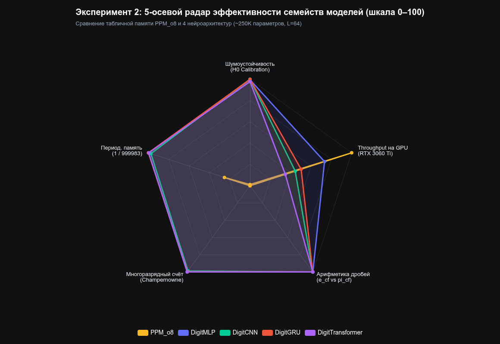
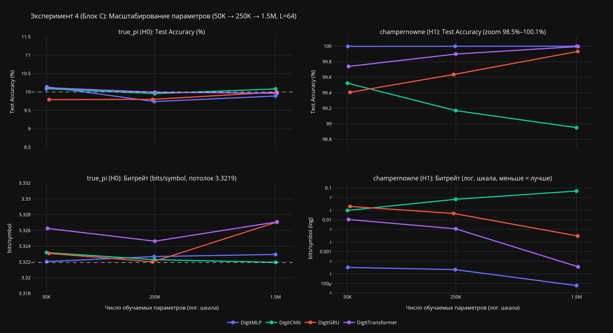
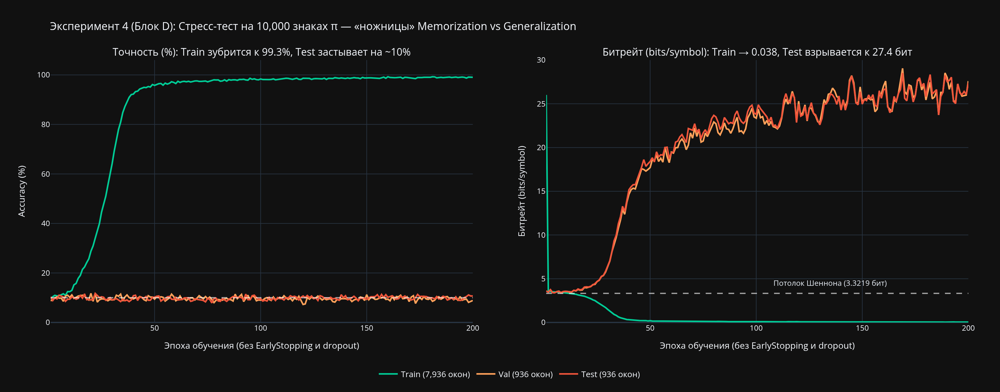

# Предсказуемость цифр числа $\pi$, математических констант и скрытых алгоритмических структур

Экспериментальное исследование на стыке глубокого обучения, теории информации и прикладного криптоанализа: можно ли по конечному окну цифр $P_\theta(x_{t+1} \mid x_{t-L+1}, \dots, x_t)$ отличить нормальную трансцендентную константу от детерминированной арифметической схемы или скрытой закладки в ГПСЧ — и как это выглядит внутри весов нейросети.

---

## 1. Постановка задачи и фальсифицируемость ($H_0$ vs $H_1$)

Рассматривается авторегрессионное предсказание следующей цифры в системе счисления $K \in \{2, 10, 11, 16\}$ на строгом хронологическом разбиении без утечек и пересечения окон (`0%–80%` Train, `80%–90%` Val, `90%–100%` Test, по умолчанию $N = 1\,000\,000$ символов, `seed = 42`).

* **Нулевая гипотеза ($H_0$ — нормальность / предел Шеннона):** для истинных цифр $\pi, e, \sqrt{2}$, цепной дроби $\pi$ и ГПСЧ (`MT19937`, `os.urandom`) ни классические алгоритмы сжатия, ни нейросети не могут обогнать потолок Шеннона на отложенной тестовой выборке:
  * Base-10: $\text{Acc} \approx 10.0\%$, $\text{Cross-Entropy} \approx \ln 10 \approx 2.3026\text{ нат}$, $\text{PPL} \approx 10.0$, битрейт $\approx \log_2 10 \approx 3.3219\text{ бит/символ}$.
* **Контроль работоспособности ($H_1$):** чтобы отделить реальный информационный барьер от ошибок в коде, пайплайн проверяется на синтетических последовательностях `hacked_pi` трёх уровней сложности с бинарной маской `mask == 1`, а также на периодических дробях (`1/97`, `1/999983`), постоянной Чемперноуна (`0.1234567891011...`) и цепной дроби числа $e$. Всегда измеряются две метрики: честная `Overall Acc` и `Targeted Acc` (строго на позициях `mask == 1`), а значимость проверяется **95% интервалом Уилсона**, биномиальным $Z$-тестом и точным парным **тестом Макнемара**.

---

## 2. Бейзлайны и архитектуры нейросетей

### Классика и не-нейросетевые бейзлайны (`src/stats_tests.py`, `src/baselines.py`)
* **Статистический аудит:** $\chi^2$ (равномерность), тест Колмогорова — Смирнова по блокам (`KS`), автокорреляционная функция (`ACF`, лаги `1..64`), `gzip` и `LZMA`.
* **Бейзлайны предсказания:** `Uniform`, цепи Маркова `Markov_k1..k3` со сглаживанием Лапласа, `LightGBM` по табличным признакам окна и табличный компрессор **PPM-C (`max_order = 8`)** с механизмом отката (`escape`) по суффиксному дереву.

### Четыре нейросетевые архитектуры (`src/models.py`)
Все модели сравниваются при сопоставимом бюджете **`medium` ($\sim 250\text{K}$ параметров)** с размерностями, кратными 8, для тензорных ядер NVIDIA RTX 3060 Ti (кроме того, в Эксперименте 4 проверяется лестница `light ~50K` $\to$ `medium ~250K` $\to$ `heavy ~1.5M`):

| Модель | Ключевая идея | Параметры (`K=10, L=64`) |
| --- | --- | :---: |
| `DigitMLP` | Embedding (`d=16`) $\to$ разворот окна `L*16` $\to$ `Linear + LayerNorm + GELU` | `247,650` |
| `DigitCNN` | Инвариантная к сдвигу дилатированная `1D-CNN`, остаточные блоки с дилатациями `(1, 2, 8, 16)`, `BatchNorm1d` | `249,658` |
| `DigitGRU` | Двухслойная однонаправленная `GRU` (нативное cuDNN-ядро, `H` кратен 8) + извлечение скрытых состояний | `242,090` |
| `DigitTransformer` | Pre-LN GPT-декодер (`3` слоя, `4` головы, `d_model=96`) с нативным `F.scaled_dot_product_attention`, **Weight Tying** (`head.weight = token_emb.weight`) и `forward_with_head_ablation()` | `250,080` |

---

## 3. Сводные результаты (Эксперименты 1–5)

### Эксперимент 1 + Фаза 3.5: True $\pi$ vs 3-уровневый Hacked $\pi$ и эталон `PPM-C`

Синтетические правила в `data/hacked_pi_tier*`:
* `Tier 1` (периодический маркер `[7, 7, 7]` каждые 50 шагов, `6.00%` маски);
* `Tier 2` (алгебраический триггер `(x[t-2]+x[t-1]+x[t]) % 7 == 0 -> x[t+2] = 9`, `13.49%` маски);
* `Tier 3` (тот же триггер срабатывает с вероятностью $p = 0.5$, остальное — истинное $\pi$, `6.90%` маски).

| Модель | `true_pi` Acc / Bits | `Tier 1` Targeted Acc / CE | `Tier 2` Targeted Acc / CE | `Tier 3` Targeted Acc / CE |
| --- | :---: | :---: | :---: | :---: |
| `PPM_o8` | `9.89%` / `3.7740` | `41.39%` / `1.6758` | `100.00%` / `0.4142` | `65.15%` / `1.0881` |
| `DigitMLP` | `9.74%` / `3.3227` | `99.98%` / `0.0456` | `100.00%` / `0.0024` | `100.00%` / `0.7047` |
| `DigitCNN` | `9.96%` / `3.3223` | `100.00%` / `1.0461` | `100.00%` / `0.000013` | `100.00%` / `0.5938` |
| `DigitGRU` | `9.80%` / `3.3220` | `100.00%` / `0.0357` | `100.00%` / `0.00037` | `100.00%` / `0.6196` |
| `DigitTransformer` | `9.99%` / `3.3246` | `100.00%` / `0.0428` | `100.00%` / `0.0024` | `100.00%` / `0.6867` |

На `true_pi` все модели строго упираются в предел Шеннона (`~10%`, `3.322–3.325` бит/символ), причём табличный `PPM_o8` переобучается на редких 8-граммах до **`3.7740` бит/символ**. На `Tier 1` без позиционных эмбеддингов `1D-CNN` не видит глобальную фазу 50 (целевой CE `1.046` против `0.036–0.046`), тогда как `Transformer` на картах внимания фокусирует `99.93%` веса на сдвиге `-50`.


---

### Эксперимент 2: Битва 9 последовательностей (константы, цепные дроби, ГПСЧ и дробь `1/999983`)

| Датасет (гипотеза, $K$) | Порог Шеннона | `PPM_o8` Acc / Bits | `LightGBM` Acc / Bits | Лучшая нейросеть (Test Acc / Bits) |
| --- | :---: | :---: | :---: | --- |
| `true_pi` ($H_0, 10$) | `3.3219` | `9.89%` / `3.7740` | `10.08%` / `3.3220` | `DigitTransformer`: `9.99%` / `3.3246` |
| `e` ($H_0, 10$) | `3.3219` | `9.93%` / `3.7737` | `10.17%` / `3.3220` | `DigitGRU`: `10.06%` / `3.3222` |
| `sqrt2` ($H_0, 10$) | `3.3219` | `10.00%` / `3.7650` | `9.85%` / `3.3221` | `DigitCNN`: `10.16%` / `3.3220` |
| `mt19937` ($H_0, 10$) | `3.3219` | `9.93%` / `3.7738` | `9.94%` / `3.3221` | `DigitCNN`: `10.09%` / `3.3219` |
| `csprng` ($H_0, 10$) | `3.3219` | `10.06%` / `3.7714` | `10.04%` / `3.3221` | `DigitTransformer`: `10.09%` / `3.3245` |
| `pi_cf` ($H_0^*, 11$) | `3.4594` | `66.44%` / `1.7977` | `69.31%` / `1.6061` | Все 4: `69.32%` / `1.5975–1.5992` ($\Delta \approx 0$ vs `Markov_k1`) |
| `rational_1_999983` ($H_1, 10$) | `3.3219` | `43.84%` / `2.4863` | `98.99%` / `0.1847` | **`DigitGRU`**: **`99.974%`** / **`0.00155`** |
| `champernowne` ($H_1, 10$) | `3.3219` | `19.99%` / `3.6368` | `65.21%` / `1.8290` | **`DigitMLP`**: **`99.998%`** / **`0.00027`** |
| `e_cf` ($H_1, 11$) | `3.4594` | `57.71%` / `2.3119` | `48.77%` / `2.7606` | **`DigitTransformer`**: **`99.996%`** / **`0.00024`** |

На цепной дроби $\pi$ (`pi_cf`, алфавит `0..9` + разделитель `10`, $N=250\,000$ через алгоритм Лемера) 69.3% точности объясняется марковской структурой первого порядка на префиксах разделителей (статистика по закону Гаусса — Кузьмина), а сверх `Markov_k1` (`1.5978` бит) ни одна нейросеть не извлекает ни сотой доли бита. Напротив, цепная дробь $e = [2; 1, 2, 1, 1, 4, 1, 1, 6, \dots]$ и константа Чемперноуна выучиваются нейросетями почти с нулевой ошибкой (`99.996%` и `99.998%`).




---

### Эксперимент 3: Влияние системы счисления (`Base-2`, `Base-10`, `Base-16` BBP)

Проверялась гипотеза о том, даёт ли формула Бэйли — Боруэйна — Плаффа (BBP) для $\pi$ в `Base-16` преимущество при локальном авторегрессионном предсказании по окну $L=64$:

| Система счисления ($K$) | Предел (бит/симв.) | `PPM_o8` нормиров. | `DigitMLP` нормиров. | `DigitCNN` нормиров. | `DigitGRU` нормиров. | `DigitTransformer` нормиров. | Макнемар vs `Uniform` |
| --- | :---: | :---: | :---: | :---: | :---: | :---: | --- |
| `Base-2` (`pi_base2`, 2) | `1.0000` | `1.00022` | `0.99999` (`50.14%`) | `1.00004` (`50.01%`) | `1.00002` (`50.01%`) | `1.00034` (`50.01%`) | $p = 1.000$ (`False`) |
| `Base-10` (`true_pi`, 10) | `3.3219` | `1.13607` | `1.00023` (`9.74%`) | `1.00011` (`9.96%`) | `1.00003` (`9.80%`) | `1.00082` (`9.99%`) | $p = 0.768$ (`False`) |
| `Base-16` (`pi_base16`, 16) | `4.0000` | `1.12019` | `1.00016` (`6.22%`) | `1.00001` (`6.25%`) | `1.00005` (`6.32%`) | `1.00047` (`6.25%`) | $p = 0.407$ (`False`) |

Нормированный битрейт `bits_per_symbol / log2(K)` во всех трёх базах равен **`1.0000–1.0008`**, а сравнение 4-битных блоков `Base-2` с одним нибблом `Base-16` даёт эквивалентный битрейт `4.0000–4.0019` бит с точностью до $10^{-4}$ бита.


---

### Эксперимент 4: Масштабирование ($L$, ёмкость `50K → 1.5M`, дробь `1/97`) и стресс-тест на зубрёжку

1. **Окно $L \in \{32, 64, 128\}$ на `true_pi`:** увеличение контекста в 4 раза не меняет результат (`9.73%–10.09%`, `3.3220–3.3300` бит).
2. **Периодическая дробь `rational_1_97` ($P=96$):** уже при $L=32 < 96$ (и для `PPM_o8`) точность равна **`100.000%`** (`Wilson CI [99.996%, 100.000%]`, $p_{\text{McNemar}} = 1.000$ между $L=64$ и $L=128$).
3. **Масштабирование ёмкости `light (~50K) → medium (~250K) → heavy (~1.5M)` при $L=64$:**
   * На `true_pi` ($H_0$): плато `9.74%–10.14%` (`3.3220–3.3271` бит).
   * На `champernowne` ($H_1$): `DigitTransformer` сжимает ошибку **в 30 раз** (`0.01020 -> 0.00521 -> 0.000335` бит, `99.995%`), `DigitGRU` сжимает `0.02622 -> 0.01581 -> 0.00310` бит (`99.931%`), `DigitMLP` доходит до `99.999%` (`0.000086` бит), тогда как `DigitCNN` без позиционных эмбеддингов деградирует (`99.52% -> 99.17% -> 98.95%`).
4. **Стресс-тест «Memorization vs Generalization»** (`DigitTransformer 1.54M`, `dropout=0`, 200 эпох на `10,000` цифрах $\pi$ без `EarlyStopping`): Train-точность взлетает с `9.48%` до **`99.27%`** (`0.0385` бит на эпохе 160), а Test-ошибка улетает в **`27.402` бит/символ** (`10.68%` на эпохе 200 — в **8.2 раза** хуже случайного угадывания из-за экстремальной переуверенности на шуме).




---

### Эксперимент 5: Механистическая интерпретируемость, крипто-аудитор ГПСЧ и BBP-оракул

1. **Геометрия эмбеддингов и Causal Head Ablation:**
   * В PCA-проекции `token_emb.weight` соседние цифры сближены на `rational_1_999983` (`adj_cos_0_to_8 = +0.1400` против `nonadj = -0.0147`, циклический порядок `0.80`) и `e_cf` (`+0.0842`), а у переобученного `memorization_10k_heavy` таблица вырождается в изотропный шум (`+0.0053` vs `+0.0020`).
   * Нулевая абляция голов выявляет на `e_cf` специализированную арифметическую голову **`L0-H2`** (`-1.92 п.п.`, `+0.160 бит`, $p < 10^{-300}$ на чётных индексах `2k`, но строго `0.00 п.п.` на маркерах `1, ;`), а на `champernowne` — ведущую голову **`L0-H3`** (`-1.58 п.п.`, $p < 10^{-300}$).
2. **Linear Probing (Trained vs Untrained, `8,000 / 2,000`):**
   * На латентных переменных `champernowne` (`champ_pos` / `champ_carry`) обученная рекуррентная `DigitGRU` сильно опережает `DigitTransformer` и случайный инициализатор: **`87.35%`** vs `50.60%` Untrained ($p = 1.54 \cdot 10^{-198}$) и **`98.48%`** Balanced Acc (vs `66.25%` / `71.19%` у Трансформера).
   * На локально определимых фазах (`e_cf_phase`, `rat97_phase`) оба необученных энкодера уже дают `100%` (эффект линейного резервуара на окне `L=64/128`).
3. **Крипто-аудитор ГПСЧ (`csprng_backdoor`):** в поток `os.urandom` внедрена редкая двухлаговая закладка плотностью **`4.07%`** (`if (x[t-24]+x[t-7])%10==0 and x[t-1]<4 -> (4*x[t-24]+x[t-7]+5)%10`). Классика полностью слепа ($\chi^2\ p = 0.9566$, `KS` $p = 0.1974$, $\max|\text{ACF}| = 0.00269$, `PPM_o8` Targeted = `9.93%`), тогда как `DigitGRU` находит `43.17%` триггеров ($p = 3.03 \cdot 10^{-27}$), а **`DigitTransformer`** вскрывает закладку с **`100.000%` Targeted Acc** (`4,119/4,119`, $Z = +40.62\sigma$, голова **`L0-H1`** кладёт **`69.43%`** внимания ровно на `t-24` и **`30.56%`** на `t-7` — суммарно **`99.99%`**).
4. **Координатный BBP-оракул ($n \to d_n$, 20 бит индекса $n$):** на `pi_base16` (`DigitMLP` `6.26%`, `DigitTransformer` `6.20%`, $p_{\text{McNemar}} \ge 0.20$) и `true_pi` (`10.00%` / `9.83%`, $p \ge 0.35$) нейросети без внешнего модуля модульной арифметики не способны восстановить $n$-ю цифру по бинарной координате.


---

## 4. Lessons Learned (Что пошло не так и неожиданные находки)

1. **Комбинаторное «проклятие краткости» на дроби `1/97` ($P=96$):** гипотеза о резком фазовом переходе между $L=64 < 96$ и $L=128 > 96$ не подтвердилась, потому что внутри 96-значного периода 3–4-граммы практически уникальны ($10^3 = 1000 \gg 96$). Место в цикле однозначно определяется уже по 3–4 цифрам — поэтому даже `PPM_o8` и `L=32` сразу берут `100.0%`. Для чистого теста барьера памяти нужен период $P \gg 10^4$ (как `1/999983`) или период над малым алфавитом (`Base-2`).
2. **Взрыв контекстов у `PPM-C (order=8)`:** на `Base-10` и `Base-16` пространство 8-грамм огромно ($10^8$, $16^8$), таблица не встречает повторных суффиксов и за счёт escape-откатов проваливается хуже равномерного шума (`3.774` бит в `Base-10`, `4.481` в `Base-16`), но в `Base-2` ($2^8 = 256$) держит идеальные `1.0002` бит.
3. **Упор в VRAM (8 GB) на `heavy` Трансформере (`1.54M`):** фоновые процессы ОС оставили `2.21 GB` свободной памяти $\to$ `CUDA OOM` на `batch_size=1024`. Снижение батча до `256` + `PYTORCH_CUDA_ALLOC_CONF=expandable_segments:True` + сохранение прогресса через `partial_metrics.csv` и переход на нативный `SDPA` (с ремаппингом legacy-ключей `nn.MultiheadAttention`) полностью решили проблему.
4. **Алгебраическая ловушка в черновой формуле крипто-закладки:** исходная идея `(3*x[t-24] + x[t-7] + 1) % 10` при условии `(x[t-24]+x[t-7])%10==0 и x[t-24]==x[t-1]` выродилась в `(2a + 1) % 10`, генерируя только нечётные цифры `{1, 3, 5, 7, 9}`, из-за чего её мгновенно ловил обычный $\chi^2$-тест ($p = 3.94 \cdot 10^{-19}$). Пришлось заменить её на биективное отображение `(4*x[t-24] + x[t-7] + 5) % 10` под `x[t-1] < 4`, вернув частоту цифр к идеальной равномерности ($p = 0.9566$).
5. **Инвариантность `1D-CNN` мешает при масштабировании:** без позиционной разметки увеличение числа параметров на `champernowne` усилило локальное переобучение и *ухудшило* `DigitCNN` (`99.52% -> 98.95%`), тогда как `DigitTransformer` сократил ошибку в 30 раз.

---

## 5. Limitations & Future Work

* **Ограничения текущей версии:** базовая длина последовательностей $N = 10^6$ ($2.5 \cdot 10^5$ для `pi_cf` из-за стоимости алгоритма Лемера); нейросетевые прогоны выполнены на фиксированном `seed = 42` без усреднения по 3–5 независимым сидам; отрицательный результат на BBP-оракуле относится к прямой подаче битов индекса $n$ в стандартный MLP/Transformer без встроенных арифметических примитивов.
* **Дальнейшие шаги (отдельным PR):**
  * **Фаза 5:** университетская веб-лаборатория на FastAPI + Plotly + PyEcharts (`web/app.py`) с живым GPU-инференсом, конструктором пользовательских дробей и формул через `mpmath`, интерактивным обнулением голов внимания и крипто-песочницей.
  * **Фаза 6:** финальная синтетическая документация по материалам [docs/RESEARCH_LOG.md](docs/RESEARCH_LOG.md).

---

## 6. Воспроизведение

**Аппаратный и программный стенд:** `AMD Ryzen 5 5600X` + `NVIDIA GeForce RTX 3060 Ti (8 GB)`, Linux, `Python 3.14.7`, `PyTorch 2.15.0+cu132` (CUDA `13.2`, AMP), `seed = 42` (в `requirements.txt` указаны совместимые границы `>=`, начиная с `torch>=2.2.0`, `numpy>=1.26.0`).

```bash
python -m venv venv
source venv/bin/activate
pip install -r requirements.txt

# 1. Генерация и кэширование последовательностей в data/ + классическая статистика
python experiments/01_generate_data.py

# 2. Не-нейросетевые и табличные бейзлайны (Uniform, Markov k=1..3, LightGBM)
python experiments/02_run_baselines.py

# 3. Эксперимент 1 (True Pi vs 3-Tier Hacked Pi) и Фаза 3.5 (PPM-C order=8)
for arch in mlp cnn gru transformer; do
  python experiments/03_exp1_sanity_check.py --arch "$arch"
done
python experiments/03b_phase3_5_ppm.py

# 4. Эксперимент 2: битва 9 последовательностей (при дефиците VRAM возможен прогон по --arch)
python experiments/04_exp2_constants.py --arch all

# 5. Эксперимент 3: Base-2 vs Base-10 vs Base-16 (BBP)
python experiments/05_exp3_bases.py --arch all

# 6. Эксперимент 4: масштабирование окна L, ёмкости и стресс-тест на 10K знаках пи
PYTORCH_CUDA_ALLOC_CONF=expandable_segments:True python experiments/06_exp4_scaling.py

# 7. Эксперимент 5: механистическая интерпретируемость, крипто-аудитор ГПСЧ и BBP-оракул
python experiments/07_exp5_mech_interp_and_crypto.py
```

Полный хронологический журнал всех 15 этапов исследования, параметров и обнаруженных ошибок ведётся в [docs/RESEARCH_LOG.md](docs/RESEARCH_LOG.md), правила и дорожная карта зафиксированы в [AGENTS.md](AGENTS.md).
