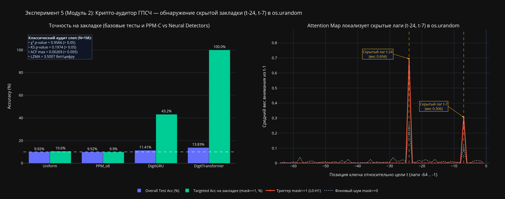

# Pi-Predictability-Lab

[](https://github.com/w0rsty/Pi-Predictability-Lab/actions/workflows/ci.yml)


[](LICENSE)

Является ли последовательность цифр числа $\pi$ неотличимой от равномерного шума, остаётся одним из старейших открытых вопросов теории чисел (гипотеза нормальности). В машинном обучении эта задача интересна и с методической стороны: попытки «предсказать» следующие цифры $\pi$ нейросетями появляются регулярно, но при аккуратной проверке почти всегда сводятся к перекрытию окон между обучением и тестом или к запоминанию короткого отрезка.

**Pi-Predictability-Lab** проверяет границы авторегрессионного предсказания на иррациональных константах с недоказанной нормальностью ($\pi, e, \sqrt{2}$), в системах счисления `Base-2 / 10 / 16` и на ГПСЧ на выборках до $10^6$ символов с хронологическим разбиением `80 / 10 / 10`. Чтобы отделить информационный предел от ошибок в коде, четыре сопоставимые архитектуры (`DigitMLP`, `DigitCNN`, `DigitGRU`, `DigitTransformer`) и компрессор `PPM-C` проверяются параллельно на константах ($H_0$) и на алгоритмически заданных рядах ($H_1$: периодические дроби, цепная дробь $e$, константа Чемперноуна и скрытая закладка в `os.urandom`).

| Заявление | Доказательство (цифры) | Ограничение |
| --- | --- | --- |
| Иррациональные константы ($\pi, e, \sqrt{2}$) и ГПСЧ неотличимы для моделей от равномерного кода $\log_2 K$ | `9.74–10.16%` в Base-10 (`3.3219–3.3248` бит/символ при пределе `3.3219`), $p_{\text{McNemar}} \in [0.17, 0.97]$ vs `Markov_k3` | На `N=99,936` окнах `MDE = 0.27` п.п. (`80%` power); один `seed=42`; слабые корреляции $< 0.27$ п.п. неразличимы |
| Представление $\pi$ в `Base-16` (мотивация BBP) и 20-битный координатный оракул $n \to d_n$ не дают авторегрессионного выигрыша | `Base-16`: `6.22–6.32%` (`4.0000–4.0019` бит, предел `4.0`); $n \to d_n$: `6.20–6.26%` (`Base-16`), `9.83–10.00%` (`Base-10`), $p \ge 0.205$ | Цифры сгенерированы `mpmath`, а не формулой BBP по модулю; для $n \to d_n$ не добавлялся позитивный контроль вроде `n mod 7` |
| На новых числах (`e_cf`, `champernowne`) нейросети обходят суффиксную память `PPM_o8` и периодические тесты | `e_cf`: `DigitTransformer` `99.996%` (`0.00024` бит) vs `PPM_o8` `57.71%`; `champernowne`: `DigitMLP` `99.998%` vs `PPM_o8` `19.99%` | В `champernowne` после позиции `488,889` идут только 6-значные числа `100000..185184` — сети выучили шаг 6, а не произвольный счётчик |
| Масштабирование окна (`L=32..128`) и весов (`50K..1.5M`) не помогает на $\pi$, а снятие регуляризации ведёт к запоминанию Train | `true_pi`: `9.73–10.14%`, $\|Z\| \le 2.84\sigma$; на `10K` знаках за `200` эпох `1.54M` модель даёт `99.03%` Train (`99.27%` на эп. 160) и `27.402` бит на Test | `patience=1` в блоке `L={32,64,128}` на $H_0$; `1/97` решается уже при `L=32` из-за уникальности 2-грамм ($10^2 > 97$) |
| `DigitTransformer` находит двухлаговую закладку в `os.urandom`, незаметную для $\chi^2$, KS, ACF и `PPM_o8` | Overall `13.85%` (`Z = +40.62σ`), Targeted на `mask==1` `100.00%` (`4,119/4,119`, `Z = +192.54σ`); классика $\chi^2\ p=0.957$, `PPM_o8` `9.93%` | Плотность триггеров `4.066%` (каскад даёт `~+3.4σ` к `4.000%`); не проверялись BigCrush/PractRand, `MLP`, `CNN` и перебор пар лагов |
| Абляция и линейное зондирование выделяют функциональные роли голов внимания и рекуррентной памяти | Поправка Холма по `96` тестам: `28/96` значимы, на `true_pi` `0/12`; `L0-H2` на `e_cf` даёт `-1.92` п.п. на `2k` и `0.00` п.п. на `1, ;` | `e_cf_phase` и `rat97_phase` линейно разделимы и без обучения (`100%`); исторический прогон probing не имел зазора `window_size` на стыке |


## Основное сравнение на 9 последовательностях (`L = 64`)

Полная таблица метрик лежит в [`results/04_exp2_constants/metrics.csv`](results/04_exp2_constants/metrics.csv), а парные тесты Макнемара в [`results/04_exp2_constants/stat_audit.json`](results/04_exp2_constants/stat_audit.json). Все модели обучались с хронологическим разбиением `80 / 10 / 10` (`N = 1,000,000`, для `pi_cf` — `250,000` токенов), `seed = 42`.

| Датасет ($K$, группа) | Порог $\log_2 K$ | `PPM_o8` Acc / Bits | `LightGBM` Acc / Bits | Лучшая нейросеть (Acc / Bits) |
| --- | :---: | :---: | :---: | --- |
| `true_pi` (10, $H_0$) | `3.3219` | `9.89%` / `3.7740` | `10.08%` / `3.3220` | `DigitTransformer`: `9.99%` / `3.3246` |
| `e` (10, $H_0$) | `3.3219` | `9.93%` / `3.7737` | `10.17%` / `3.3220` | `DigitGRU`: `10.06%` / `3.3222` |
| `sqrt2` (10, $H_0$) | `3.3219` | `10.00%` / `3.7650` | `9.85%` / `3.3221` | `DigitCNN`: `10.16%` / `3.3220` |
| `mt19937` (10, $H_0$) | `3.3219` | `9.93%` / `3.7738` | `9.94%` / `3.3221` | `DigitCNN`: `10.09%` / `3.3219` |
| `csprng` (10, $H_0$) | `3.3219` | `10.06%` / `3.7714` | `10.04%` / `3.3221` | `DigitTransformer`: `10.09%` / `3.3245` |
| `pi_cf` (11, $H_0^*$) | `3.4594` | `66.44%` / `1.7977` | `69.31%` / `1.6061` | Все 4: `69.32%` / `1.5975–1.5992` |
| `rational_1_999983` (10, $H_1$) | `3.3219` | `43.84%` / `2.4863` | `98.99%` / `0.1847` | `DigitGRU`: `99.974%` / `0.00155` |
| `champernowne` (10, $H_1$) | `3.3219` | `19.99%` / `3.6368` | `65.21%` / `1.8290` | `DigitMLP`: `99.998%` / `0.00027` |
| `e_cf` (11, $H_1$) | `3.4594` | `57.71%` / `2.3119` | `48.77%` / `2.7606` | `DigitTransformer`: `99.996%` / `0.00024` |

## Карта проекта (`01..07`) и архитектуры

```text
├── configs/config.yaml   # Параметры данных, сплита 80/10/10 и дефолты обучения
├── docs/RESEARCH_LOG.md  # Хронология гипотез, ошибок, формул и замеров
├── experiments/          # Скрипты 01..07 исследовательского пайплайна
├── notebooks/            # Разведка данных и разбор методических ловушек
├── results/              # Итоговые таблицы CSV/JSON и PNG-графики по этапам 01..07
├── src/                  # Генераторы, Dataset, бейзлайны, модели, тренер и viz/
└── tests/                # CPU-тесты каузальности, zero-leakage, статистики и PPM-C
```

Базовое сопоставление нейросетей ведётся в бюджете `~250K` обучаемых параметров при выравнивании размерностей кратно 8 под Tensor Cores (`RTX 3060 Ti`):

| Модель | Конфигурация ([`src/models.py`](src/models.py)) | Параметры (`K=10, L=64`) |
| --- | --- | :---: |
| `DigitMLP` | Embedding `d=16`, разворот `L*16`, три блока `Linear + LayerNorm + GELU` | `247,650` |
| `DigitCNN` | Дилатированная `1D-CNN`, 4 остаточных блока `(1, 2, 8, 16)` с `BatchNorm1d` | `249,658` |
| `DigitGRU` | Двухслойная `GRU` (`H=160` для `cuDNN`) + выходная проекция в `FP32` | `242,090` |
| `DigitTransformer` | Pre-LN GPT-декодер (`3` слоя, `4` головы, `d_model=96`), каузальный `SDPA`, Weight Tying | `250,080` |

## Детализация экспериментов (`01..07`)

### 01–03. Статистика, бейзлайны и проверка пайплайна (`hacked_pi`)

В [`results/01_classical_stats/metrics.csv`](results/01_classical_stats/metrics.csv) на `1,000,000` цифр константы $\pi, e, \sqrt{2}$ и оба ГПСЧ проходят тест $\chi^2$ ($p \in [0.054, 0.940]$) и блочный тест Колмогорова–Смирнова ($p \in [0.243, 0.924]$). В [`results/02_baselines/metrics.csv`](results/02_baselines/metrics.csv) и [`results/03_exp1_sanity/ppm_vs_neural_comparison.csv`](results/03_exp1_sanity/ppm_vs_neural_comparison.csv) три синтетические закладки на $\pi$ подтверждают чувствительность пайплайна: на периодическом маркере `Tier 1` (период 50) лидирует `DigitGRU` (`Targeted CE = 0.0357`), на модульной сумме `Tier 2` — `DigitCNN` (`0.000013`), а на зашумлённом правиле `Tier 3` (`p = 0.5`) `DigitCNN` выходит на байесовский предел уверенности (`55.28%` при оптимуме `55.0%`).


### 05. Системы счисления `Base-2 / 10 / 16`

Формула Бэйли–Боруэйна–Плаффа (BBP, 1997) послужила мотивацией проверить, появится ли в шестнадцатеричной записи $\pi$ локальный сигнал, доступный авторегрессии. Последовательности `pi_base2` (`1M` бит), `true_pi` и `pi_base16` (`1M` нибблов, сверенных побитно с `pi_base2` без единого расхождения) получены через `mpmath` ([`results/05_exp3_bases/metrics.csv`](results/05_exp3_bases/metrics.csv)). И 4-битный блок `Base-2`, и 1 символ `Base-16` упираются в один и тот же теоретический потолок `4.0000` бит (`4.0000–4.0019` бит), а парный тест Макнемара против `Uniform` не выявляет значимого сдвига ни в одном основании (минимальное сырое `p = 0.0584` у `PPM_o8` на `Base-16`; у нейросетей $p \in [0.085, 1.000]$).

<details>
<summary>Таблица: нормированный битрейт (bits / log2 K) и тест Макнемара по трём основаниям</summary>

| База ($K$) | Предел (бит) | `PPM_o8` (норм.) | `DigitMLP` | `DigitCNN` | `DigitGRU` | `DigitTransformer` | Макнемар vs `Uniform` (Transformer / мин. по моделям) |
| --- | :---: | :---: | :---: | :---: | :---: | :---: | --- |
| `Base-2` (2) | `1.0000` | `1.00022` | `0.99999` (`50.14%`) | `1.00004` (`50.01%`) | `1.00002` (`50.01%`) | `1.00034` (`50.01%`) | `1.000` / `0.461` |
| `Base-10` (10) | `3.3219` | `1.13607` | `1.00023` (`9.74%`) | `1.00011` (`9.96%`) | `1.00003` (`9.80%`) | `1.00082` (`9.99%`) | `0.768` / `0.085` |
| `Base-16` (16) | `4.0000` | `1.12019` | `1.00016` (`6.22%`) | `1.00001` (`6.25%`) | `1.00005` (`6.32%`) | `1.00047` (`6.25%`) | `0.407` / `0.058` |

</details>

### 06. Масштабирование (`L = 32..128`, `50K–1.5M`) и тест на запоминание

Расширение окна и увеличение числа параметров с `~50K` до `~1.54M` ([`results/06_exp4_scaling/metrics.csv`](results/06_exp4_scaling/metrics.csv)) на `true_pi` не меняет результат (`9.73–10.14%`, $|Z| \le 2.84\sigma$). На `champernowne` рост бюджета у `DigitTransformer` снижает ошибку в `30` раз (`0.01020 -> 0.000335` бит, `99.995%`), тогда как `DigitCNN` проседает (`99.52% -> 98.95%`). Если на `10,000` знаках $\pi$ отключить `dropout` и `EarlyStopping`, `1.54M` модель к `160`-й эпохе вызубривает Train до `99.27%` (`0.0385` бит), а к `200`-й эпохе заканчивает на `99.03%` Train при `10.68%` Test и `27.402` бит/символ кросс-энтропии ([`memorization_curve.csv`](results/06_exp4_scaling/memorization_curve.csv)).


### 07. Механистический анализ, детектор закладок в ГПСЧ и BBP-оракул

1. **Геометрия эмбеддингов ([`embedding_geometry.json`](results/07_exp5_mech_interp/embedding_geometry.json)):** у `DigitTransformer` на структурированных рядах средний косинус соседних цифр `0..8` выше, чем несоседних (`rational_1_999983`: `+0.1400` против `-0.0147`; `e_cf`: `+0.0842` против `+0.0140`; `champernowne`: `+0.0699` против `-0.0011`), тогда как на `true_pi` оба значения близки (`+0.0604` против `+0.0441`). Метрика циклического порядка в 2D PCA (`0.70–0.80`) близка к случайному ожиданию для 10 точек (`~0.62`), поэтому для оценки структуры используется разность косинусов (в обновлённом скрипте `07` дополнена перестановочным тестом на `10,000` перестановок).
2. **Абляция голов внимания ([`head_ablation.csv`](results/07_exp5_mech_interp/head_ablation.csv)):** из `96` парных тестов Макнемара при сыром пороге `p < 0.05` срабатывают `37`, после поправки Холма — Бонферрони остаются `28`. Оба случайных выброса на контроле `true_pi` (`L2-H3` `p = 0.0042` и `L0-H2` `p = 0.0056`) отсеиваются поправкой (`p_holm = 0.270` и `0.354`, `0/12` значимых голов на `true_pi` без каких-либо исключений). На `e_cf` голова `L0-H2` отвечает за чётные термы `2k` (`-1.92` п.п., $p_{\text{holm}} < 10^{-300}$) и не влияет на маркеры `1, ;` (`0.00` п.п., $p_{\text{holm}} = 1.0$), а на `champernowne` главная роль сосредоточена в `L0-H3` (`-1.58` п.п., $p_{\text{holm}} < 10^{-300}$).
3. **Линейное зондирование ([`linear_probing.csv`](results/07_exp5_mech_interp/linear_probing.csv)):** задачи `e_cf_phase` и `rat97_phase` достигают `100.0%` уже на необученных сетях за счёт линейной разделимости коротких суффиксов и неинформативны. На `champernowne` обученная `DigitGRU` (`H = 160`) лучше кодирует позицию цифры (`87.35%` против `66.25%` у `DigitTransformer` с `d_model = 96`) и границу переноса разряда (`Balanced Acc` `98.48%` против `71.19%`).
4. **Детектор закладки в `os.urandom` ([`results/07_exp5_mech_interp/metrics.csv`](results/07_exp5_mech_interp/metrics.csv)):** биективное правило на лагах `t-24, t-7` (плотность `4.066%`) не даёт сдвига в базовых статистических тестах ($\chi^2\ p = 0.9566$, `KS` $p = 0.1974$, $\max|\text{ACF}| = 0.00269$ ниже порога Бонферрони `0.00336`, `lzma` `3.501` бит) и в `PPM_o8` (`9.92%` overall, `9.93%` на триггерах). `DigitGRU` поднимает точность на триггерах до `43.17%` (`Overall Acc = 11.41%`, `Overall Z = +14.86σ`, `Targeted Z = +70.95σ`), а `DigitTransformer` за счёт головы `L0-H1` (`69.43%` внимания на `t-24` и `30.56%` на `t-7`) даёт `Overall Acc = 13.85%` (`Overall Z = +40.62σ`) и `100.00%` (`4,119 / 4,119`, `Targeted Z = +192.54σ`) на позициях `mask == 1`.
5. **Координатный оракул ($n \to d_n$):** предсказание по 20 битам индекса не даёт сигнала ни на `pi_base16` (`6.26%` у `DigitMLP`, `6.20%` у `DigitTransformer`, $p_{\text{McNemar}} \ge 0.205$), ни на `true_pi` (`10.00%` и `9.83%`, $p \ge 0.352$).



## Ограничения (Limitations)

1. **Статистическая мощность и один сид:** на `N = 99,936` тестовых окнах в Base-10 стандартная ошибка равна `SE = 0.095` п.п., а минимально детектируемый эффект при мощности `80%` (`alpha = 0.05`) составляет `MDE = 0.27` п.п. — сверхслабые закономерности ниже этого порога эксперимент не различает. Все основные прогоны выполнены при `seed = 42` без усреднения по нескольким сидам, а базовые прогоны `true_pi` переиспользовались между Экспериментами 1–3.
2. **Структура `champernowne` и дрейф `BatchNorm1d`:** префикс до `99,999` занимает `488,889` цифр, поэтому весь Val и Test состоят только из 6-значных чисел `100000..185184` (а `LightGBM`, обученный на префиксе `200K`, видел лишь 1–5-значные числа, из-за чего его `65.21%` являются артефактом обрезки). Наблюдаемая просадка `DigitCNN` (`99.52% -> 98.95%`) может объясняться как отсутствием позиционных эмбеддингов, так и дрейфом статистик `BatchNorm1d` — изолирующий контрольный запуск `LayerNorm`-свёртки не проводился.
3. **Ускоренные режимы и отсутствие позитивных контролей:** в Exp 4 Блоке A использовался `patience = 1`, что недостаточно для медленной оптимизации. В BBP-оракуле ($n \to d_n$) отсутствует синтетический позитивный контроль (например, `n mod 7` или `popcount(n)`) для подтверждения обучаемости 20-битной координатной MLP/Transformer-модели.
4. **Не-i.i.d. скользящие окна и probing:** на структурированных рядах (`e_cf`, `rational_1_97`, probing) соседние окна сильно коррелированы, поэтому реальное число степеней свободы задаётся числом периодов, а не числом окон. В историческом прогоне `linear_probing.csv` на границе `8,000 / 2,000` присутствовало перекрытие `window_size - 1` токенов (`63` при `L=64`, `127` при `L=128`), а у `GRU` и `Transformer` различались размерности признаков (`160` vs `96`); в актуальном `07_exp5` добавлен зазор `+ window_size`, проверка сходимости LBFGS и `PR-AUC` для `champ_carry`.
5. **Охват крипто-аудита и детерминизм `csprng`:** в `csprng_backdoor` последовательная перезапись `digits[t]` слегка сдвигала плотность срабатываний до `4.066%` (`40,660 / 10^6`, `~+3.4σ` от `4.00%`). Набор детекторов ограничен базовыми тестами и `PPM_o8` без крипто-батарей вроде `TestU01 BigCrush` / `PractRand`, без перебора пар лагов и без запуска `MLP`, `DigitCNN` и `LightGBM` на этой выборке. Исторический кэш `csprng` генерировался через недетерминированный `os.urandom` (в текущей версии `src/data_generator.py` добавлен детерминированный режим на `SHAKE-256` и проверка `SHA-256` кэша).

## Связанные работы (Related Work)

- Zhang, C., Bengio, S., Hardt, M., Recht, B., & Vinyals, O. (2017). *Understanding deep learning requires rethinking generalization* — контекст стресс-теста запоминания случайной последовательности на `10K` знаках $\pi$.
- Olsson, C., Elhage, N., Nanda, N., et al. (2022). *In-context Learning and Induction Heads* — контекст по-головной абляции специализированных цепей внимания (`L0-H2`, `L0-H1`).
- Bailey, D. H., Borwein, P. B., & Plouffe, S. (1997). *On the Rapid Computation of Various Polylogarithmic Constants* — формула извлечения $n$-го шестнадцатеричного знака $\pi$, мотивировавшая тест `Base-16` и координатного оракула.
- Cleary, J. G., & Witten, I. H. (1984). *Data Compression Using Adaptive Coding and Partial String Matching* — алгоритм `PPM-C`, использованный как табличный суффиксный ориентир.
- L'Ecuyer, P., & Simard, R. (2007). *TestU01: A C Library for Empirical Testing of Random Number Generators* — стандартный контекст эмпирического аудита ГПСЧ (выходящий за рамки базового набора тестов этого стенда).

## Воспроизведение и ноутбуки

Исходные эксперименты выполнены на Linux (`AMD Ryzen 5 5600X`, `NVIDIA RTX 3060 Ti 8 GB`, `Python 3.14.7`, `PyTorch 2.15.0+cu132`); в [`pyproject.toml`](pyproject.toml) и [`requirements.txt`](requirements.txt) указаны минимальные совместимые версии (`Python >= 3.11`, `PyTorch >= 2.4`). Разборы черновых проверок и артефактов собраны в [`docs/RESEARCH_LOG.md`](docs/RESEARCH_LOG.md) и двух выполненных ноутбуках: [`01_quick_sanity_check.ipynb`](notebooks/01_quick_sanity_check.ipynb) и [`02_leakage_illusion_and_dead_ends.ipynb`](notebooks/02_leakage_illusion_and_dead_ends.ipynb).

```bash
python -m venv venv
source venv/bin/activate
pip install -e ".[dev]"

./reproduce.sh --quick   # py_compile + CPU pytest + двусторонний smoke-тест (H1 1/97 и H0 шум)
./reproduce.sh --full    # Полный цикл экспериментов 01..07 (нужна CUDA)
```

## Инструменты разработки

AI-ассистенты использовались как инженерный инструмент для ускорения шаблонного кода, рефакторинга и построения графиков. Постановка гипотез и экспериментов, статистическая верификация, разбор ограничений и финальный аудит кода выполнены автором проекта.
