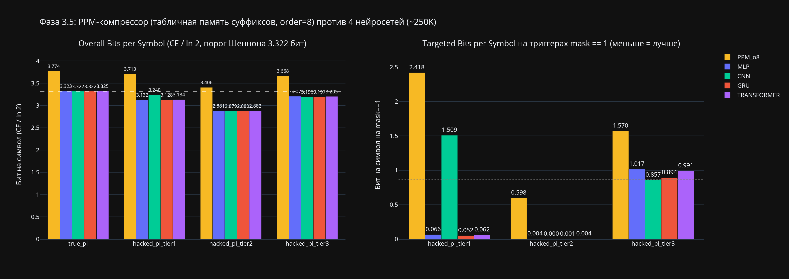
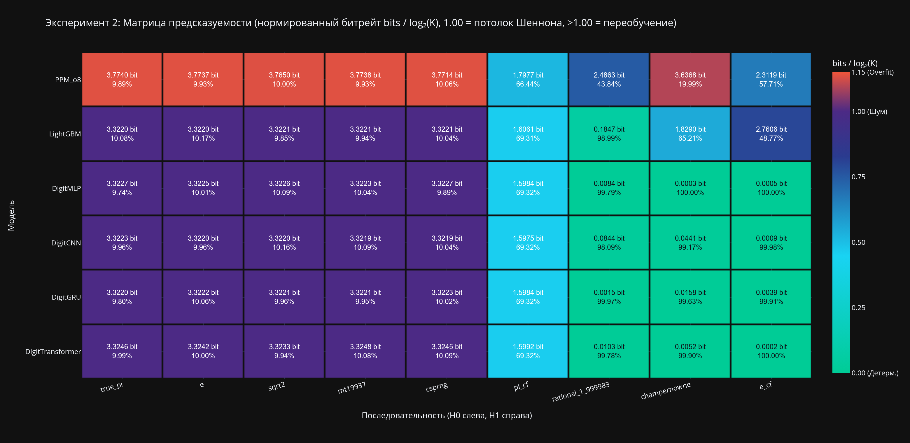
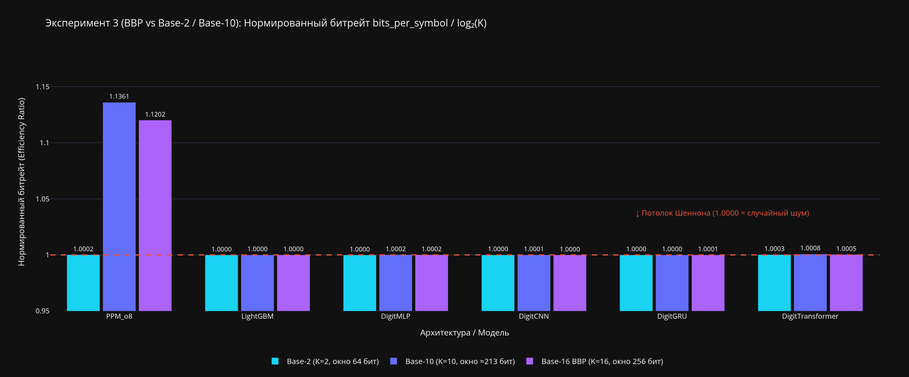
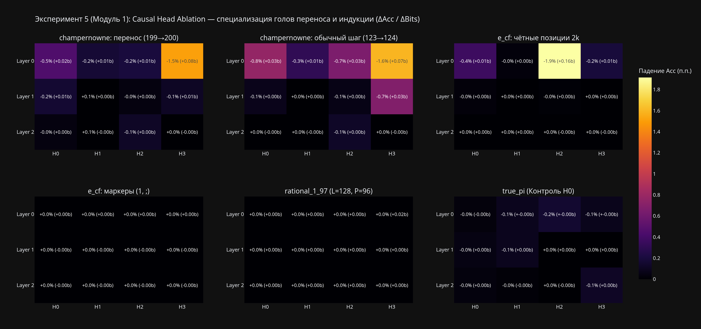

# Предсказуемость цифр числа $\pi$, математических констант и скрытых алгоритмических структур

Мне стало интересно проверить на практике: если скормить современным нейросетям миллион цифр числа $\pi$ и не допускать случайных утечек между train и test, смогут ли они вытащить хоть сотую долю бита ниже предела Шеннона — или любые истории про «нейросеть взломала $\pi$» сводятся к переобучению и дырявому сплиту?

Чтобы не гадать, я собрал экспериментальный стенд на домашнем ПК (`AMD Ryzen 5 5600X + NVIDIA RTX 3060 Ti 8 GB`) и прогнал 5 больших экспериментов: от классической статистики и табличного компрессора `PPM-C` до `Causal Mini-Transformer`, механистической интерпретируемости (PCA эмбеддингов, абляция голов внимания, линейные зонды) и поиска стеганографических закладок в криптостойком ГПСЧ.

---

## 1. Постановка задачи и фальсифицируемость ($H_0$ vs $H_1$)

Решается авторегрессионная задача предсказания следующего символа $P_\theta(x_{t+1} \mid x_{t-L+1}, \dots, x_t)$ в системах счисления $K \in \{2, 10, 11, 16\}$. Разбиение строго хронологическое без пересечения окон (`0%–80%` Train, `80%–90%` Val, `90%–100%` Test, $N = 1\,000\,000$ символов, `seed = 42`, проверка в [`verify_zero_leakage`](src/dataset.py)).

* **Нулевая гипотеза ($H_0$):** для нормальных констант ($\pi, e, \sqrt{2}$), цепной дроби $\pi$ и ГПСЧ (`MT19937`, `os.urandom`) на отложенном тесте модели не могут пробить теоретический предел Шеннона:
  * для Base-10: $\text{Acc} \approx 10.0\%$, $\text{CE} \approx \ln 10 \approx 2.3026\text{ нат}$, $\text{PPL} \approx 10.0$, битрейт $\approx \log_2 10 \approx 3.3219\text{ бит/символ}$.
* **Контроль работоспособности ($H_1$):** чтобы нулевой результат на $\pi$ не объяснялся сломанным кодом, пайплайн сначала проверяется на синтетических последовательностях `hacked_pi` трёх уровней сложности с бинарной маской `mask == 1`, а также на периодических дробях (`1/97`, `1/999983`), постоянной Чемперноуна (`0.1234567891011...`) и цепной дроби числа $e$. Везде считаются **две** метрики: честная `Overall Acc` и `Targeted Acc` (строго по `mask == 1`), а значимость оценивается по **95% интервалу Уилсона**, $Z$-тесту и точному парному **тесту Макнемара**.

---

## 2. Модели и бейзлайны

### Классика и не-нейросетевые эталоны ([`src/stats_tests.py`](src/stats_tests.py), [`src/baselines.py`](src/baselines.py))
* **Статистический аудит:** $\chi^2$ равномерности, блочный тест Колмогорова — Смирнова (`KS`), автокорреляция `ACF` (лаги `1..64`), `gzip` и `LZMA`.
* **Бейзлайны:** `Uniform`, цепи Маркова `Markov_k1..k3` со сглаживанием Лапласа, `LightGBM` по 64 признакам окна и собственный векторизованный компрессор **PPM-C (`max_order = 8`)** с escape-откатом по суффиксному дереву.

### Четыре нейросети ([`src/models.py`](src/models.py))
Основное сравнение проведено в равном бюджете **`medium` ($\sim 250\text{K}$ параметров)** с размерностями, кратными 8, под Tensor Cores RTX 3060 Ti (а в Эксперименте 4 проверяется лестница `light ~50K` $\to$ `medium ~250K` $\to$ `heavy ~1.5M`):

| Модель | Идея архитектуры | Параметров (`K=10, L=64`) |
| --- | --- | :---: |
| `DigitMLP` | Embedding (`d=16`) $\to$ разворот окна `L*16` $\to$ `Linear + LayerNorm + GELU` | `247,650` |
| `DigitCNN` | Инвариантная к сдвигу `1D-CNN`, 4 остаточных блока с дилатациями `(1, 2, 8, 16)` | `249,658` |
| `DigitGRU` | Двухслойная `GRU` (нативный `cuDNN`, `H=160` кратно 8) + извлечение скрытых состояний | `242,090` |
| `DigitTransformer` | Pre-LN GPT-декодер (`3` слоя, `4` головы, `d_model=96`), нативный `SDPA`, **Weight Tying** и по-головая абляция | `250,080` |

---

## 3. Главные результаты (Эксперименты 1–5)

### Эксперимент 1 и PPM-C: `true_pi` против 3 уровней `hacked_pi`

В `hacked_pi` внутрь истинных цифр $\pi$ замешаны детерминированные правила:
* `Tier 1` (периодический маркер `[7, 7, 7]` каждые 50 шагов, `6.00%` маски);
* `Tier 2` (алгебраическая формула `(x[t-2]+x[t-1]+x[t]) % 7 == 0 -> x[t+2] = 9`, `13.49%` маски);
* `Tier 3` (то же правило срабатывает лишь в `50%` случаев, остальное — настоящее $\pi$, `6.90%` маски).

| Модель | `true_pi` Acc / Bits | `Tier 1` Targeted Acc / CE | `Tier 2` Targeted Acc / CE | `Tier 3` Targeted Acc / CE |
| --- | :---: | :---: | :---: | :---: |
| `PPM_o8` | `9.89%` / `3.7740` | `41.39%` / `1.6758` | `100.00%` / `0.4142` | `65.15%` / `1.0881` |
| `DigitMLP` | `9.74%` / `3.3227` | `99.98%` / `0.0456` | `100.00%` / `0.0024` | `100.00%` / `0.7047` |
| `DigitCNN` | `9.96%` / `3.3223` | `100.00%` / `1.0461` | `100.00%` / `0.000013` | `100.00%` / `0.5938` |
| `DigitGRU` | `9.80%` / `3.3220` | `100.00%` / `0.0357` | `100.00%` / `0.00037` | `100.00%` / `0.6196` |
| `DigitTransformer` | `9.99%` / `3.3246` | `100.00%` / `0.0428` | `100.00%` / `0.0024` | `100.00%` / `0.6867` |

На `true_pi` все 4 нейросети упираются ровно в потолок Шеннона (`~10%`, `3.322–3.325` бит), тогда как табличный `PPM_o8` переобучается на редких 8-суффиксах до **`3.7740` бит/символ**. На `Tier 1` сдвигово-инвариантная `1D-CNN` не видит глобальную дистанцию 50 (целевой CE `1.046` против `0.036` у `GRU`), а `DigitTransformer` фокусирует `99.93%` веса внимания ровно на сдвиге `-50`. На `Tier 3` `DigitCNN` выходит точно на теоретический байесовский оптимум (`55.28%` уверенности при оптимуме `55.0%`).




---

### Эксперимент 2: Битва 9 последовательностей (константы, цепные дроби, ГПСЧ и `1/999983`)

| Датасет (гипотеза, $K$) | Порог Шеннона | `PPM_o8` Acc / Bits | `LightGBM` Acc / Bits | Лучшая нейросеть (Test Acc / Bits) |
| --- | :---: | :---: | :---: | --- |
| `true_pi` ($H_0, 10$) | `3.3219` | `9.89%` / `3.7740` | `10.08%` / `3.3220` | `DigitTransformer`: `9.99%` / `3.3246` |
| `e` ($H_0, 10$) | `3.3219` | `9.93%` / `3.7737` | `10.17%` / `3.3220` | `DigitGRU`: `10.06%` / `3.3222` |
| `sqrt2` ($H_0, 10$) | `3.3219` | `10.00%` / `3.7650` | `9.85%` / `3.3221` | `DigitCNN`: `10.16%` / `3.3220` |
| `mt19937` ($H_0, 10$) | `3.3219` | `9.93%` / `3.7738` | `9.94%` / `3.3221` | `DigitCNN`: `10.09%` / `3.3219` |
| `csprng` ($H_0, 10$) | `3.3219` | `10.06%` / `3.7714` | `10.04%` / `3.3221` | `DigitTransformer`: `10.09%` / `3.3245` |
| `pi_cf` ($H_0^*, 11$) | `3.4594` | `66.44%` / `1.7977` | `69.31%` / `1.6061` | Все 4: `69.32%` / `1.5975–1.5992` ($\Delta \approx 0$ vs `Markov_k1`) |
| `rational_1_999983` ($H_1, 10$) | `3.3219` | `43.84%` / `2.4863` | `98.99%` / `0.1847` | **`DigitGRU`**: **`99.974%`** / **`0.00155`** |
| `champernowne` ($H_1, 10$) | `3.3219` | `19.99%` / `3.6368` | `65.21%` / `1.8290` | **`DigitMLP`**: **`99.998%`** / **`0.00027`** |
| `e_cf` ($H_1, 11$) | `3.4594` | `57.71%` / `2.3119` | `48.77%` / `2.7606` | **`DigitTransformer`**: **`99.996%`** / **`0.00024`** |

На цепной дроби $\pi$ (`pi_cf`, алфавит `0..9` + разделитель `10`, $N=250\,000$ через алгоритм Лемера) 69.3% точности — это чисто марковская статистика первого порядка на парах `(цифра -> разделитель)` и распределение Гаусса — Кузьмина; сверх `Markov_k1` (`1.5978` бит) нейросети не извлекают ни сотой доли бита. Зато цепная дробь $e = [2; 1, 2, 1, 1, 4, 1, 1, 6, \dots]$ и постоянная Чемперноуна выучиваются практически до нуля (`99.996%` и `99.998%`), тогда как табличный `PPM_o8` бессилен, потому что числа $n$ и $2k$ на тесте встречаются впервые.




---

### Эксперимент 3: Системы счисления `Base-2`, `Base-10` и `Base-16` (проверка BBP)

Самая любопытная проверка: формула Бэйли — Боруэйна — Плаффа (BBP, 1995) позволяет вычислять $n$-ю шестнадцатеричную цифру $\pi$ напрямую без вычисления предыдущих. Даст ли запись в `Base-16` хоть какой-то сигнал для локальной авторегрессии при окне $L=64$ (`256` бит контекста)?

| Система счисления ($K$) | Предел (бит/симв.) | `PPM_o8` нормиров. | `DigitMLP` нормиров. | `DigitCNN` нормиров. | `DigitGRU` нормиров. | `DigitTransformer` нормиров. | Макнемар vs `Uniform` |
| --- | :---: | :---: | :---: | :---: | :---: | :---: | --- |
| `Base-2` (`pi_base2`, 2) | `1.0000` | `1.00022` | `0.99999` (`50.14%`) | `1.00004` (`50.01%`) | `1.00002` (`50.01%`) | `1.00034` (`50.01%`) | $p = 1.000$ (`False`) |
| `Base-10` (`true_pi`, 10) | `3.3219` | `1.13607` | `1.00023` (`9.74%`) | `1.00011` (`9.96%`) | `1.00003` (`9.80%`) | `1.00082` (`9.99%`) | $p = 0.768$ (`False`) |
| `Base-16` (`pi_base16`, 16) | `4.0000` | `1.12019` | `1.00016` (`6.22%`) | `1.00001` (`6.25%`) | `1.00005` (`6.32%`) | `1.00047` (`6.25%`) | $p = 0.407$ (`False`) |

Во всех трёх базах нормированный битрейт `bits_per_symbol / log2(K)` равен **`1.0000–1.0008`**, а 4-битный блок `Base-2` и 1 ниббл `Base-16` совпадают до $10^{-4}$ бита (`4.0000–4.0019` бит). Авторегрессионной зацепки BBP не создаёт.



---

### Эксперимент 4: Масштабирование ($L$, `50K → 1.5M`, `1/97`) и стресс-тест на зубрёжку

1. **Окно $L \in \{32, 64, 128\}$ на `true_pi`:** увеличение контекста в 4 раза ничего не меняет (`9.73–10.09%`, `3.3220–3.3300` бит).
2. **Дробь `1/97` ($P=96$):** уже при $L=32 < 96$ (и у `PPM_o8`) точность равна **`100.000%`** (`Wilson CI [99.996%, 100.000%]`, $p_{\text{McNemar}} = 1.000$ между $L=64$ и $L=128$).
3. **Масштабирование `50K → 250K → 1.5M` при $L=64$:**
   * На `true_pi`: ровное плато `9.74–10.14%` (`3.3220–3.3271` бит).
   * На `champernowne`: `DigitTransformer` сжимает ошибку **в 30 раз** (`0.01020 -> 0.00521 -> 0.000335` бит, `99.995%`), `DigitGRU` сжимает `0.02622 -> 0.01581 -> 0.00310` бит (`99.931%`), `DigitMLP` доходит до `99.999%` (`0.000086` бит), тогда как `DigitCNN` без позиционных эмбеддингов деградирует (`99.52% -> 99.17% -> 98.95%`).
4. **Стресс-тест на зубрёжку** (`DigitTransformer 1.54M`, `dropout=0`, 200 эпох на `10,000` знаках $\pi$ без `EarlyStopping`): Train-точность взлетает с `9.48%` до **`99.27%`** (`0.0385` бит на эпохе 160), а Test-ошибка улетает в **`27.402` бит/символ** (`10.68%` на эпохе 200 — в **8.2×** хуже случайного шума).


---

### Эксперимент 5: Мехинтерп, крипто-аудитор ГПСЧ и BBP-оракул

1. **Геометрия `token_emb` и Causal Head Ablation:**
   * На алгоритмических задачах (`rational_1_999983` с `adj_cos_0_to_8 = +0.1400` vs `nonadj = -0.0147`, `e_cf` `+0.0842`) эмбеддинги выстраиваются в упорядоченную структуру, а при зубрёжке `10K pi` матрица превращается в изотропный шум (`+0.0053` vs `+0.0020`).
   * По-головая нулевая абляция выявляет на `e_cf` арифметическую голову **`L0-H2`** (`-1.92 п.п.`, `+0.160 бит`, $p < 10^{-300}$ на чётных индексах `2k`, но ровно `0.00 п.п.` на маркерах `1, ;`), а на `champernowne` — ведущую голову **`L0-H3`** (`-1.58 п.п.`, $p < 10^{-300}$).
2. **Linear Probing (Trained vs Untrained, `8,000 / 2,000`):**
   * На скрытых переменных счётчика `champernowne` обученная `DigitGRU` уверенно бьёт и необученный инициализатор, и трансформер: `champ_pos` — **`87.35%`** vs `50.60%` Untrained ($p = 1.54 \cdot 10^{-198}$; у `Transformer` `66.25%`), `champ_carry` (Balanced Acc) — **`98.48%`** vs `87.12%` (у `Transformer` `71.19%`).
   * На `e_cf_phase` и `rat97_phase` даже необученные модели дают `100%` (эффект линейного Echo State резервуара на коротком суффиксе).
3. **Крипто-аудитор ГПСЧ (`csprng_backdoor`):** в поток `os.urandom` внедрена двухлаговая закладка плотностью **`4.07%`** (`if (x[t-24]+x[t-7])%10==0 and x[t-1]<4 -> (4*x[t-24]+x[t-7]+5)%10`). Классика полностью слепа ($\chi^2\ p = 0.9566$, `KS` $p = 0.1974$, $\max|\text{ACF}| = 0.00269$, `PPM_o8` Targeted = `9.93%`). При этом `DigitGRU` находит `43.17%` триггеров ($p = 3.03 \cdot 10^{-27}$), а **`DigitTransformer` ловит закладку со `100.000%` Targeted Acc** (`4,119/4,119`, $Z = +40.62\sigma$), причём голова **`L0-H1`** кладёт **`69.43%`** внимания на `t-24` и **`30.56%`** на `t-7` (**`99.99%`** всей массы).
4. **Координатный BBP-оракул ($n \to d_n$, 20 бит индекса):** на `pi_base16` (`DigitMLP = 6.26%`, `DigitTransformer = 6.20%`, $p_{\text{McNemar}} \ge 0.20$) и `true_pi` (`10.00%` / `9.83%`, $p \ge 0.35$) без встроенной модульной арифметики стандартная нейросеть не может предсказать $n$-й знак по битам $n$.




---

## 4. Что пошло не так и неожиданные находки (Lessons Learned)

1. **Промах с гипотезой на дроби `1/97` ($P = 96$):** я был уверен, что между $L=64 < 96$ и $L=128 > 96$ случится фазовый переход точности. Но уже короткие $k$-граммы ($k \ge 2$, проверено в блокноте: все `96/96` двузначных подстрок в периоде уникальны на `100%`) однозначно задают позицию в цикле — поэтому даже $L=32$ и `PPM_o8` сразу взяли `100.0%`. Для чистого теста барьера памяти нужен период $P \gg 10^4$ (`1/999983`) или малый алфавит (`Base-2`).
2. **Взрыв контекстов у `PPM-C (order=8)`:** в `Base-10` и `Base-16` 8-граммы почти не повторяются, таблица дробится, и за счёт escape-откатов `PPM_o8` сжимает шум хуже равномерного кода (`3.774` / `4.481` бит), хотя в `Base-2` ($2^8 = 256$) держит честные `1.0002` бита.
3. **Упор в 8 GB VRAM на `heavy` Трансформере (`1.54M`):** когда рабочий стол отъел часть видеопамяти и осталось `2.21 GB`, на `batch_size=1024` словил `CUDA OOM`. Помогло снижение батча до `256`, `PYTORCH_CUDA_ALLOC_CONF=expandable_segments:True`, дозапуск через `partial_metrics.csv` и переход с `nn.MultiheadAttention` на нативный `SDPA` (с ремаппингом legacy-чекпойнтов).
4. **Баг в первой формуле крипто-закладки:** черновая схема `(3*x[t-24] + x[t-7] + 1) % 10` при условии `(x[t-24]+x[t-7])%10==0 и x[t-24]==x[t-1]` алгебраически свернулась в `(2a + 1) % 10` и выдавала только нечётные цифры `{1, 3, 5, 7, 9}` — $\chi^2$-тест сразу её спалил ($p = 3.94 \cdot 10^{-19}$). Пришлось переписать на биективную `(4*a + b + 5) % 10` при `x[t-1] < 4` ($\chi^2\ p = 0.9566$).
5. **Деградация `1D-CNN` при росте ёмкости:** на `champernowne` отсутствие позиционных эмбеддингов привело к тому, что при переходе `50K -> 250K -> 1.5M` свёрточная сеть стала только хуже (`99.52% -> 99.17% -> 98.95%`), а трансформер сократил ошибку в 30 раз.

---

## 5. Ограничения и что планирую сделать дальше

* **Текущие ограничения:** длина рядов $N = 10^6$ ($2.5 \cdot 10^5$ для `pi_cf` из-за цены длинной арифметики Лемера); прогоны выполнены на фиксированном `seed = 42` без усреднения по нескольким сидам; отрицательный результат в BBP-оракуле относится к прямой подаче бинарной координаты $n$ в MLP/Transformer без встроенных арифметических примитивов.
* **Дальнейшие планы (отдельным PR на ветке `feat/web-laboratory`):**
  * интерактивная веб-лаборатория (`FastAPI + Jinja2 + Plotly.js / ECharts.js`) с конструктором произвольных дробей и формул через `mpmath`, живым обнулением голов внимания на RTX 3060 Ti и песочницей крипто-аудитора ГПСЧ.

---

## 6. Воспроизведение

**Стенд:** `AMD Ryzen 5 5600X` + `NVIDIA GeForce RTX 3060 Ti (8 GB)`, Linux, `Python 3.14.7`, `PyTorch 2.15.0+cu132` (CUDA `13.2`, AMP), `seed = 42` (в [`requirements.txt`](requirements.txt) указаны совместимые границы `>=`, начиная с `torch>=2.2.0`, `numpy>=1.26.0`).

```bash
python -m venv venv
source venv/bin/activate
pip install -r requirements.txt

# Полный прогон от генерации данных до Эксперимента 5:
./reproduce.sh
```

Пошагово те же этапы лежат в `experiments/01..07_*.py`. Подробная хронология, разбор ошибок и замеры — в [`docs/RESEARCH_LOG.md`](docs/RESEARCH_LOG.md), гиперпараметры — в [`configs/config.yaml`](configs/config.yaml), быстрый разведочный sanity-check — в [`notebooks/01_quick_sanity_check.ipynb`](notebooks/01_quick_sanity_check.ipynb).
