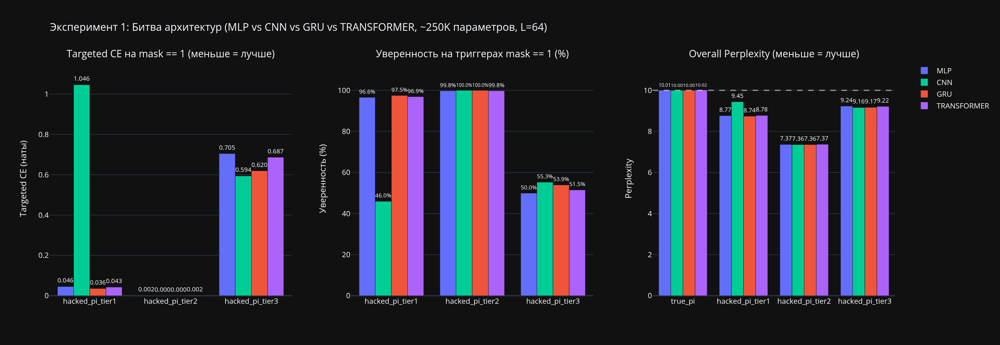

# Pi-Predictability-Lab

Авторегрессионная проверка гипотезы нормальности $\pi$, $e$, $\sqrt{2}$, записи BBP в `Base-16` и ГПСЧ против алгоритмических последовательностей и скрытых закладок в `os.urandom`. На миллионах цифр реальных констант при честном хронологическом сплите нейросети (`MLP`, `1D-CNN`, `GRU`, `Causal Transformer`) и `PPM-C` держатся строго на теоретическом потолке Шеннона, но на синтетических правилах, алгоритмических рядах и стеганографической закладке в `csprng` с плотностью `4.07%` трансформер выбивает `100.00%` Targeted Accuracy и локализует скрытые лаги через карты внимания.


## Главные результаты в цифрах

1. **Истинные константы и BBP (`Base-2 / 10 / 16`):** на `true_pi`, `e`, `sqrt2`, `mt19937`, `csprng` и шестнадцатеричной BBP-записи $\pi$ нормированный битрейт всех четырёх архитектур равен `1.0000-1.0008` от предела $\log_2 K$ (`9.74-10.16%` в Base-10; $p_{\text{McNemar}} \in [0.17, 1.00]$).
2. **Опровержение «взлома $\pi$»:** 4-битный блок `Base-2` и 1 ниббл `Base-16` совпадают по энтропии до $10^{-4}$ бита (`4.0000-4.0019` бит), прямая подача 20-битной координаты $n \to d_n$ даёт случайные `6.20-6.26%` (`Base-16`) и `9.83-10.00%` (`Base-10`), а стресс-тест на `10,000` знаках $\pi$ за 200 эпох без EarlyStopping приводит к жёсткому переобучению (`99.27%` на Train против `27.402` бит/символ на Test).
3. **Нейросети против табличной памяти (`PPM-C`):** на `champernowne` и `e_cf` новые числа и коэффициенты `2k` на тесте встречаются впервые, поэтому `PPM_o8` падает (`19.99%` и `57.71%`), тогда как нейросети обобщают правило генерации до `99.996-99.998%` (`0.00024` бит/символ у `DigitTransformer` на `e_cf`).
4. **Механистическая интерпретируемость и крипто-аудитор:** в `csprng_backdoor` классические тесты ($\chi^2\ p=0.9566$, `KS` $p=0.1974$, $\max|\text{ACF}|=0.00269$) и `PPM_o8` (`9.93%`) закладку не видят, а голова `L0-H1` у `DigitTransformer` концентрирует `99.99%` веса внимания строго на скрытых лагах `t-24` (`69.43%`) и `t-7` (`30.56%`). На `e_cf` обнуление головы `L0-H2` ломает точность на чётных позициях `2k` (`-1.92` п.п., $p < 10^{-300}$) и не трогает маркеры `1` и `;`.

## Архитектура стенда и контроль утечек

Все эксперименты поставлены на одном компьютере (`AMD Ryzen 5 5600X`, `NVIDIA RTX 3060 Ti 8 GB`, `seed = 42`, хронологический сплит `80% / 10% / 10%` без пересечения окон через [`verify_zero_leakage`](src/dataset.py)). В [`tests/`](tests/) вынесена автоматическая проверка нулевой утечки сплита и строгой авторегрессионной каузальности через PyTorch autograd ($\partial \text{logit}_t / \partial E(x_{>t}) = 0$).

Нейросети сравниваются в согласованном бюджете `~250K` параметров (`L = 64`), размеры тензоров кратны 8 для ядер Tensor Cores:

| Модель | Краткое описание ([`src/models.py`](src/models.py)) | Параметры (`K=10, L=64`) |
| --- | --- | :---: |
| `DigitMLP` | Embedding `d=16`, разворот `L*16`, три блока `Linear + LayerNorm + GELU` | `247,650` |
| `DigitCNN` | Сдвигово-инвариантная 1D-TCN, 4 остаточных блока с дилатациями `(1, 2, 8, 16)` | `249,658` |
| `DigitGRU` | Двухслойная `GRU` (`H=160` кратно 8 под `cuDNN`) с экстракцией $h_t$ | `242,090` |
| `DigitTransformer` | GPT-декодер (`3` слоя, `4` головы, `d_model=96`), нативный `SDPA`, Weight Tying и Head Ablation | `250,080` |

## Результаты ключевых экспериментов

### Сравнение 9 последовательностей (константы, ГПСЧ, `1/999983`, Чемперноун, цепные дроби)


Ключевой контраст наглядно виден при сравнении табличного компрессора и нейросетей. На дробях и счётчике алгоритмическое правило переносится на отложенный кусок последовательности, тогда как на всех десятичных $H_0$-рядах нейросети не сдвигаются ни на миллибит ниже $\log_2 10 \approx 3.3219$, а на `pi_cf` упираются ровно в марковский предел 1-го порядка (`69.32%`, `1.5978` бит за счёт пар `(цифра -> разделитель)` и распределения Гаусса-Кузьмина).

<details>
<summary>Полная таблица по 9 датасетам (Test Accuracy / bits per symbol, L=64)</summary>

Полные CSV-таблицы и парный аудит Макнемара лежат в [`results/03_exp2_constants/metrics.csv`](results/03_exp2_constants/metrics.csv) и [`results/03_exp2_constants/stat_audit.json`](results/03_exp2_constants/stat_audit.json).

| Датасет ($K$, группа) | Порог $\log_2 K$ | `PPM_o8` Acc / Bits | `LightGBM` Acc / Bits | Лучшая нейросеть (Acc / Bits) |
| --- | :---: | :---: | :---: | --- |
| `true_pi` (10, $H_0$) | `3.3219` | `9.89%` / `3.7740` | `10.08%` / `3.3220` | `DigitTransformer`: `9.99%` / `3.3246` |
| `e` (10, $H_0$) | `3.3219` | `9.93%` / `3.7737` | `10.17%` / `3.3220` | `DigitGRU`: `10.06%` / `3.3222` |
| `sqrt2` (10, $H_0$) | `3.3219` | `10.00%` / `3.7650` | `9.85%` / `3.3221` | `DigitCNN`: `10.16%` / `3.3220` |
| `mt19937` (10, $H_0$) | `3.3219` | `9.93%` / `3.7738` | `9.94%` / `3.3221` | `DigitCNN`: `10.09%` / `3.3219` |
| `csprng` (10, $H_0$) | `3.3219` | `10.06%` / `3.7714` | `10.04%` / `3.3221` | `DigitTransformer`: `10.09%` / `3.3245` |
| `pi_cf` (11, $H_0^*$) | `3.4594` | `66.44%` / `1.7977` | `69.31%` / `1.6061` | Все 4: `69.32%` / `1.5975-1.5992` |
| `rational_1_999983` (10, $H_1$) | `3.3219` | `43.84%` / `2.4863` | `98.99%` / `0.1847` | `DigitGRU`: `99.974%` / `0.00155` |
| `champernowne` (10, $H_1$) | `3.3219` | `19.99%` / `3.6368` | `65.21%` / `1.8290` | `DigitMLP`: `99.998%` / `0.00027` |
| `e_cf` (11, $H_1$) | `3.4594` | `57.71%` / `2.3119` | `48.77%` / `2.7606` | `DigitTransformer`: `99.996%` / `0.00024` |

</details>

### Контрольный стенд (`hacked_pi`), системы счисления и `PPM-C`

Чтобы нулевой результат на $\pi$ не объяснялся ошибкой обучения, пайплайн проверен на трёх синтетических правилах (`hacked_pi_tier1..3`) с маской модифицированных индексов `mask == 1` ([`results/02_exp1_sanity/ppm_vs_neural_comparison.csv`](results/02_exp1_sanity/ppm_vs_neural_comparison.csv)): периодический маркер `[7, 7, 7]` каждые 50 шагов, модульная формула `(x[t-2]+x[t-1]+x[t]) % 7 == 0 -> x[t+2] = 9` и та же формула с вероятностью `p = 0.5`.



<details>
<summary>Метрики контрольных тестов (`hacked_pi`) и сравнения систем счисления (`Base-2 / 10 / 16`)</summary>

**1. Контрольный тест `true_pi` против `hacked_pi` (Targeted Acc и CE/Bits на `mask == 1`):**

| Модель | `true_pi` Acc / Bits | `Tier 1` (period 50) | `Tier 2` (mod 7) | `Tier 3` (noisy p=0.5) |
| --- | :---: | :---: | :---: | :---: |
| `PPM_o8` | `9.89%` / `3.7740` | `41.39%` / `1.6758` CE | `100.00%` / `0.4142` CE | `65.15%` / `1.0881` CE |
| `DigitMLP` | `9.74%` / `3.3227` | `99.98%` / `0.0456` CE | `100.00%` / `0.0024` CE | `100.00%` / `0.7047` CE |
| `DigitCNN` | `9.96%` / `3.3223` | `100.00%` / `1.0461` CE | `100.00%` / `0.000013` CE | `100.00%` / `0.5938` CE |
| `DigitGRU` | `9.80%` / `3.3220` | `100.00%` / `0.0357` CE | `100.00%` / `0.00037` CE | `100.00%` / `0.6196` CE |
| `DigitTransformer` | `9.99%` / `3.3246` | `100.00%` / `0.0428` CE | `100.00%` / `0.0024` CE | `100.00%` / `0.6867` CE |

**2. Сравнение систем счисления (`results/04_exp3_bases/metrics.csv`):**

| База ($K$) | Предел (бит) | `PPM_o8` (норм.) | `DigitMLP` | `DigitCNN` | `DigitGRU` | `DigitTransformer` | Макнемар vs `Uniform` |
| --- | :---: | :---: | :---: | :---: | :---: | :---: | --- |
| `Base-2` (2) | `1.0000` | `1.00022` | `0.99999` (`50.14%`) | `1.00004` (`50.01%`) | `1.00002` (`50.01%`) | `1.00034` (`50.01%`) | $p = 1.000$ |
| `Base-10` (10) | `3.3219` | `1.13607` | `1.00023` (`9.74%`) | `1.00011` (`9.96%`) | `1.00003` (`9.80%`) | `1.00082` (`9.99%`) | $p = 0.768$ |
| `Base-16` BBP (16) | `4.0000` | `1.12019` | `1.00016` (`6.22%`) | `1.00001` (`6.25%`) | `1.00005` (`6.32%`) | `1.00047` (`6.25%`) | $p = 0.407$ |

</details>

### Масштабирование, «ножницы» запоминания и рентген схем

При масштабировании бюджета от `50K` до `1.5M` параметров на `champernowne` ошибка `DigitTransformer` падает в 30 раз (`0.01020 -> 0.00521 -> 0.000335` бит, `99.995%`), тогда как `1D-CNN` без позиционных эмбеддингов постепенно теряет точность (`99.52% -> 99.17% -> 98.95%`). В стресс-тесте на `10,000` знаках $\pi$ без регуляризации модель `1.54M` зазубривает Train до `99.27%`, а ошибка на Test взлетает в `8.2` раза выше случайного шума (`27.402` бит/символ).


Разбор внутренних представлений ([`results/06_exp5_mech_interp/`](results/06_exp5_mech_interp/)) показывает противоположную геометрию весов: на `rational_1_999983` и `e_cf` эмбеддинги цифр выстраиваются вдоль соседних переходов (`adj_cos = +0.1400` и `+0.0842`), а при зубрёжке `10K` знаков $\pi$ рассыпаются в шум (`+0.0053`). На латентных переменных `champernowne` (позиция цифры в числе и флаг переноса разряда) линейный зонд на обученной `DigitGRU` достигает `87.35%` и `98.48%` Balanced Acc против `50.60%` и `87.12%` на случайной инициализации.


<details>
<summary>Графики радара, масштабирования 50K-1.5M, PCA-геометрии и Linear Probing</summary>

1. 5-осевой радар семейств моделей: [`results/03_exp2_constants/exp2_radar_pyecharts.png`](results/03_exp2_constants/exp2_radar_pyecharts.png)
2. Масштабирование окна `L={32,64,128}` и ёмкости `50K-1.5M`: [`results/05_exp4_scaling/exp4_window_phase_transition.png`](results/05_exp4_scaling/exp4_window_phase_transition.png), [`results/05_exp4_scaling/exp4_capacity_scaling.png`](results/05_exp4_scaling/exp4_capacity_scaling.png)
3. PCA эмбеддингов и Linear Probing: [`results/06_exp5_mech_interp/exp5_embedding_clock_pca.png`](results/06_exp5_mech_interp/exp5_embedding_clock_pca.png), [`results/06_exp5_mech_interp/exp5_linear_probing_bars.png`](results/06_exp5_mech_interp/exp5_linear_probing_bars.png)

</details>

## Что сломалось по пути и как проверялось

Разбор провалов и ограничений подробно задокументирован в [`docs/RESEARCH_LOG.md`](docs/RESEARCH_LOG.md) и в двух выполненных ноутбуках:

1. [`notebooks/01_quick_sanity_check.ipynb`](notebooks/01_quick_sanity_check.ipynb): первичная проверка частот $\pi$, сравнение `mpmath` с длинным делением для дробей и обнаружение 100%-й уникальности 2-грамм в периоде `1/97` ($10^2 = 100 > 97$, из-за чего ожидаемый фазовый переход на `L=64 -> 128` не понадобился).
2. [`notebooks/02_leakage_illusion_and_dead_ends.ipynb`](notebooks/02_leakage_illusion_and_dead_ends.ipynb): экспериментальная проверка ловушки `shuffle=True` на окнах `L=64`, сравнение сломанной черновой закладки `_legacy_biased_backdoor_v1` (вырождавшейся в нечётные цифры и палившейся по $\chi^2$ при $p = 3.94 \cdot 10^{-19}$) с биективной `apply_csprng_backdoor`, а также проверка границы $10^k > P$ для `1/7`, `1/19`, `1/97`, `1/997`.

## Воспроизведение и структура проекта

Стенд проверен на Linux (`Python 3.14.7`, `PyTorch 2.15.0+cu132`, CUDA AMP), для сторонней установки в [`pyproject.toml`](pyproject.toml) и [`requirements.txt`](requirements.txt) заданы мягкие границы зависимостей (`torch>=2.2.0`, `numpy>=1.26.0`).

```bash
python -m venv venv
source venv/bin/activate
pip install -e ".[dev]"

# Быстрая проверка (<30с): py_compile, pytest и smoke-тест сплита + PPM-C на 1/97
./reproduce.sh --quick

# Полный цикл экспериментов 01..07 на GPU
./reproduce.sh --full
```

```text
├── configs/config.yaml        # Параметры данных, окон и обучения
├── docs/RESEARCH_LOG.md       # Журнал гипотез, ошибок и замеров
├── experiments/               # Скрипты 01..07 исследовательского цикла
├── notebooks/                 # Разведка данных и разбор ловушек (.ipynb с PNG)
├── results/                   # Отобранные CSV, JSON и PNG для всех 6 этапов
├── src/                       # Генератор, датасеты, бейзлайны, модели, тренер и viz/
├── tests/                     # Автотесты каузальности, zero-leakage, PPM-C и статистики
├── pyproject.toml             # Конфигурация пакета и pytest
└── reproduce.sh               # Режимы --quick и --full
```
